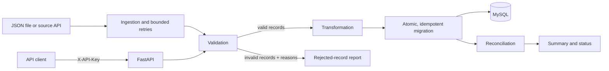

# Billing Data Migration Pipeline

[](https://github.com/swapnilpawar0204/billing-data-migration-pipeline/actions/workflows/ci.yml)

A Python service for validating, normalizing, migrating, and reconciling billing transactions. It exposes a FastAPI REST API, uses SQLAlchemy with MySQL, supports a CLI for JSON files or a source API, and runs in Docker Compose.

> **Project status:** portfolio / learning project. It demonstrates several reliability patterns, but it is not a production-certified financial system. Cloud deployment, metrics/alerting, rate limiting, TLS termination, and managed schema migrations are not included.

## What it demonstrates

- **Idempotency:** `external_transaction_id` is the business key; repeated IDs are skipped and a database uniqueness constraint provides a final guard.
- **Atomic writes:** a migration batch is committed as one database transaction; database errors roll the batch back.
- **Data quality:** invalid records are rejected with reasons rather than silently discarded.
- **Safe money handling:** amounts use `Decimal` and a `NUMERIC(18,2)` database column, not binary floating point.
- **Reconciliation:** expected transaction IDs are checked against the target database after migration.
- **Resilient source calls:** the HTTP client retries timeouts, connection errors, HTTP 429, and HTTP 5xx responses with bounded exponential backoff.
- **Operational basics:** health endpoint, request correlation IDs, structured logs, API-key protection, container health checks, and CI checks.

See [architecture](docs/architecture.md), [security notes](docs/security.md), [operations runbook](docs/operations-runbook.md), and [SRE interview guide](docs/sre-interview-guide.md).

## Architecture



## Quick start with Docker Compose

Requirements: Docker Desktop with Compose enabled.

1. Copy `.env.example` to `.env`.
2. Set unique local values for `MYSQL_PASSWORD` and `MYSQL_ROOT_PASSWORD`.
3. Set a strong `SERVICE_API_KEY` and set `APP_ENV=production` for a container run so the app refuses to start without the required secrets. Keep real credentials out of Git.
4. Start the services:

```bash
docker compose up --build -d
docker compose ps
docker compose logs -f app
```

Check health and open the interactive API documentation:

```bash
curl http://localhost:8000/health
# http://localhost:8000/docs
```

Run a small migration (replace `YOUR_SERVICE_API_KEY` with the value in `.env`):

```bash
curl -X POST http://localhost:8000/api/v1/migration/run \
  -H "X-API-Key: YOUR_SERVICE_API_KEY" \
  -H "Content-Type: application/json" \
  -d '{"transactions":[{"external_transaction_id":"TXN-1","customer_id":"C-1","amount":"10.00","currency":"usd","status":"PAID"}]}'
```

Stop the containers with `docker compose down`. To also delete the local MySQL volume and its data, use `docker compose down -v` (destructive).

## Local development on Windows

Use PowerShell from the repository directory. Python 3.12 is the version used by CI; create and activate a virtual environment:

```powershell
py -3.12 -m venv .venv
.\.venv\Scripts\Activate.ps1
python -m pip install --upgrade pip
pip install -r requirements-dev.txt
```

Run tests and quality checks:

```powershell
pytest -q --cov
ruff check .
black --check .
python -m compileall -q app tests scripts
```

The tests use SQLite test databases and do not require a running MySQL server, but runtime dependencies still need to be installed. If PowerShell blocks activation, use `\.venv\Scripts\python.exe -m pytest -q --cov` or follow your organization's execution-policy guidance rather than changing system policy blindly.

Linux/macOS equivalent activation is `source .venv/bin/activate`.

## API endpoints

| Method | Path | Authentication | Purpose |
|---|---|---|---|
| `GET` | `/health` | None | Checks database connectivity; returns `503` when the database is unavailable. |
| `POST` | `/api/v1/migration/validate` | `X-API-Key` when configured | Validates and transforms up to 1,000 records without writing. |
| `POST` | `/api/v1/migration/run` | `X-API-Key` when configured | Validates, transforms, migrates, and reconciles a batch. |
| `GET` | `/api/v1/migration/status/{external_transaction_id}` | `X-API-Key` when configured | Looks up the target status for one external transaction ID. |

Responses include an `X-Request-ID`. A printable client-supplied ID is echoed (limited to 64 characters); otherwise the service generates one. Use it to correlate a request with application logs.

## CLI examples

```bash
# Read bundled JSON data
python -m app.cli --file data/sample_billing_data.json

# Fetch raw records from the configured source API
python -m app.cli --from-api
```

The CLI prints a JSON summary with counts such as `received`, `rejected`, `inserted`, `skipped_duplicates`, and `reconciled`. Rejected records are written to `data/rejected_records.json` by default; this file may contain sensitive source data and is ignored by Git.

Exit codes: `0` = reconciliation succeeded, `1` = reconciliation mismatch, `2` = source/database or execution failure. The bundled sample is intended to demonstrate accepted, duplicate, and rejected records; check the actual CLI summary rather than assuming every database starts empty.

## Configuration

| Variable | Purpose |
|---|---|
| `APP_ENV` | `development` for local work; set `production` in a secured deployment to enforce required secrets. |
| `SERVICE_API_KEY` | Inbound API key expected in the `X-API-Key` header. Empty disables API-key authentication, so only use that for isolated local development. |
| `API_BASE_URL`, `API_KEY` | External billing source URL and optional bearer token. |
| `API_TIMEOUT_SECONDS`, `API_MAX_RETRIES` | Source request timeout and bounded retry count. |
| `MYSQL_HOST`, `MYSQL_PORT`, `MYSQL_DATABASE`, `MYSQL_USER`, `MYSQL_PASSWORD` | Target database connection settings. |
| `MYSQL_ROOT_PASSWORD` | MySQL root password required by Compose initialization. |
| `LOG_LEVEL` | `DEBUG`, `INFO`, `WARNING`, `ERROR`, or `CRITICAL`. |

See `.env.example` for the full list. Never commit `.env` or paste credentials into logs, issues, or interview materials.

## Repository map

```text
app/
  api/             FastAPI routes, schemas, API-key authentication
  config/          environment-based settings and validation
  database/        SQLAlchemy engine and ORM models
  ingestion/       source API client, timeouts and retries
  validation/      validation rules and rejection reasons
  transformation/  normalization and monetary precision
  migration/       atomic insert and idempotency handling
  reconciliation/  post-migration verification
  monitoring/      database connectivity health check
  cli.py           JSON/API command-line entry point
docs/              architecture, security, operations and interview notes
tests/             unit and integration-style tests using SQLite
sql/queries.sql    reporting and reconciliation examples
```

## Known limitations / next steps

- The database schema is created with SQLAlchemy `create_all`; use Alembic for controlled schema evolution.
- API-key auth is a single shared key; rate limiting, per-client credentials, and TLS termination should be provided by a gateway in a deployed environment.
- There is no cloud deployment, infrastructure-as-code, metrics endpoint, dashboard, or alerting configuration in this repository.
- Retry backoff has no jitter and the client is a simple GET integration; production ingestion should define source pagination, rate-limit policy, and replay semantics.
- Reconciliation is an application-level verification, not an independent financial ledger/audit certification.
- Verify tests and coverage in your own environment before quoting a coverage percentage. The test files currently contain **83 test functions** by static count; the exact collected test count and coverage can vary with parametrized cases and dependency versions.

## Author

**Swapnil Pawar** — [GitHub](https://github.com/swapnilpawar0204) · [LinkedIn](https://www.linkedin.com/in/swapnil-pawar-a2907a326/)

Licensed under [LICENSE](LICENSE).
