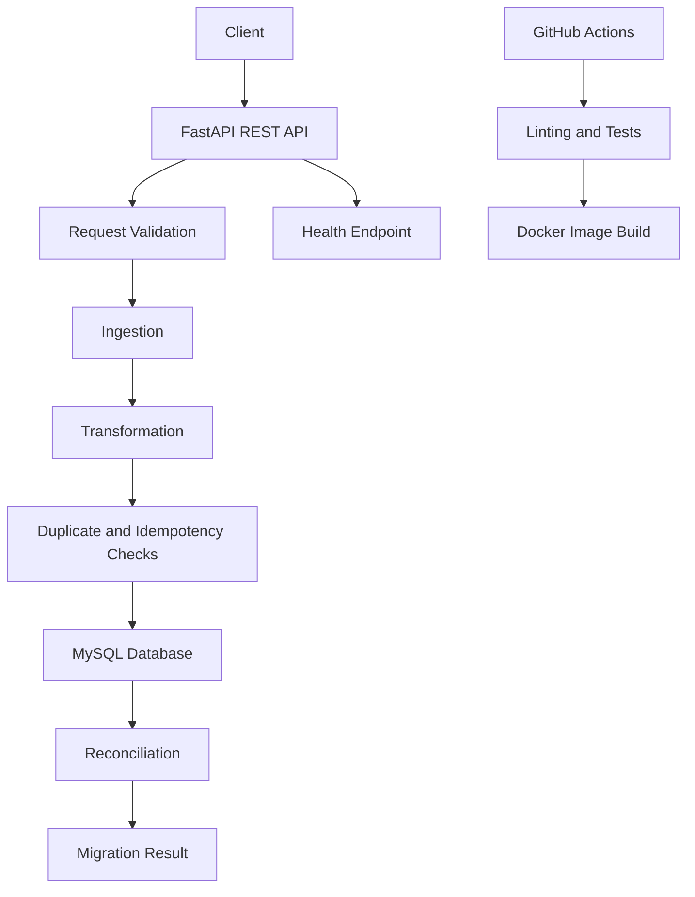

# Billing Data Migration Pipeline

A containerized REST API for validating, transforming, migrating, and reconciling billing transactions using Python, FastAPI, and MySQL.

Built to demonstrate reliable data processing, idempotent operations, automated testing, containerization, and CI/CD practices relevant to Cloud Engineering and Site Reliability Engineering.

## Project Overview

Data migration systems must handle duplicate records, invalid inputs, database errors, and inconsistent transaction counts without silently corrupting data.

This project implements a structured billing migration workflow with validation, duplicate detection, database transactions, and reconciliation checks.

**Engineering goals**
- Process billing transactions through a clear, testable pipeline.
- Prevent duplicate processing using transaction identifiers.
- Reject invalid financial data before migration.
- Support consistent database operations and rollback on failures.
- Verify migration results through reconciliation.
- Automate code quality checks and tests using GitHub Actions.

## Architecture



## Technology Stack

| Area | Technologies |
|---|---|
| Programming | Python |
| API | FastAPI, REST |
| Database | MySQL, SQLAlchemy |
| Containers | Docker, Docker Compose |
| CI/CD | GitHub Actions |
| Testing | pytest |
| Code Quality | Ruff, Black |
| Version Control | Git, GitHub |

## Key Features

### 1. Structured data migration
Processes billing data through ingestion, validation, transformation, migration, and reconciliation stages.

### 2. Idempotency and duplicate detection
Uses `external_transaction_id` to help prevent the same transaction from being processed repeatedly.

### 3. Input validation
Rejects invalid transaction data, including negative transaction amounts where prohibited by the application's validation rules.

### 4. Transaction safety
Uses database transaction handling and rollback to help preserve data consistency when a migration operation fails.

### 5. Reconciliation
Checks migration results so discrepancies between expected and migrated data can be identified.

### 6. API health checks
Provides a health endpoint designed to check application status and database connectivity separately from the core migration workflow.

### 7. Automated CI/CD checks
GitHub Actions runs configured code-quality checks, Python compilation checks, automated tests, and a Docker image build.

## Getting Started

### Prerequisites

- Git
- Docker
- Docker Compose

### 1. Clone the repository

```bash
git clone https://github.com/swapnilpawar0204/billing-data-migration-pipeline.git
cd billing-data-migration-pipeline
```

### 2. Start the application

Use the Docker Compose configuration provided in the repository:

```bash
docker compose up --build -d
```

### 3. Check container status

```bash
docker compose ps
docker compose logs
```

### 4. Check the API

If the API is configured to listen on port 8000:

```bash
curl http://localhost:8000/health
```

Open the interactive API documentation if enabled:

http://localhost:8000/docs

The exact endpoint response and available API routes depend on the current implementation.

### 5. Run the automated tests

Run tests using the project's configured Python environment and dependencies:

```bash
pytest
```

For a containerized test workflow, follow the commands documented in the repository's Docker and Compose configuration.

## Reliability and Operations

This project explores practical reliability concepts:

- **Idempotency:** reduce duplicate processing during retries.
- **Data integrity:** validate inputs and reconcile migration results.
- **Failure handling:** use transaction rollback where appropriate.
- **Health checks:** identify application and database connectivity problems.
- **Automated verification:** run tests and quality checks in CI.
- **Reproducible environments:** use Docker and Docker Compose.
- **Troubleshooting:** inspect application and container logs to investigate failures.

These practices are useful foundations for production reliability engineering. The project is a learning and demonstration environment, not a claim of production deployment.

## CI/CD Workflow

The configured GitHub Actions workflow performs checks such as:

1. Set up the Python environment.
2. Run configured linting and formatting checks.
3. Compile Python source files.
4. Execute automated tests.
5. Build the Docker image.

Refer to the workflow files in `.github/workflows/` for the exact steps and configuration.

## Current Scope

Implemented project capabilities include the migration API, MySQL integration, validation, idempotency-related checks, reconciliation, Docker Compose, automated tests, and CI checks.

Cloud deployment to GCP, AWS, or Azure is not claimed as implemented.

Prometheus/Grafana monitoring, production alerting, Kubernetes deployment, and disaster recovery automation should be added and verified before being listed as implemented capabilities.

## Future Improvements

- Add Prometheus metrics for request rate, latency, and error rate.
- Build Grafana dashboards and configure actionable alerts.
- Add structured logs and request correlation IDs.
- Test recovery from database and application failures.
- Document backup, restore, and disaster recovery procedures.
- Explore deployment to Google Cloud Platform.
- Add deployment health checks and rollback strategies.

## Learning Outcomes

This project provides hands-on practice with REST APIs, relational databases, data validation, failure handling, Docker, automated testing, and CI/CD.

It is intended to demonstrate foundational skills relevant to Cloud Engineering, DevOps, and Site Reliability Engineering.

## Author

**Swapnil Pawar**

- GitHub: https://github.com/swapnilpawar0204
- LinkedIn: https://www.linkedin.com/in/swapnil-pawar-a2907a326/

