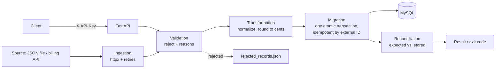

# Architecture

## Pipeline stages

| Stage | Module | Responsibility |
|---|---|---|
| Ingestion | `app/ingestion` | Fetch raw records from the billing API; retry timeouts, connection errors and HTTP 429/5xx with exponential backoff; fail fast on other 4xx. |
| Validation | `app/validation` | Required fields, non-empty identifiers, finite non-negative amount that fits `NUMERIC(18,2)`. Every rejected record is kept with all of its reasons. |
| Transformation | `app/transformation` | Trim, upper-case currency, lower-case status, blank optional fields become `NULL`, amount rounded to cents (banker's rounding). |
| Migration | `app/migration` | Inserts the whole batch in **one transaction**; any database error rolls everything back. Existing and repeated `external_transaction_id`s are skipped, so reruns are safe. Timezone-aware dates are stored as UTC. |
| Reconciliation | `app/reconciliation` | Confirms each expected ID exists exactly once; reports missing and duplicate IDs. |

## Entry points

* **REST API** (`app/main.py`, `app/api`): `POST /api/v1/migration/validate`, `POST /api/v1/migration/run`, `GET /api/v1/migration/status/{id}`, `GET /health`.
* **CLI** (`app/cli.py`): `python -m app.cli --file data/sample_billing_data.json` or `--from-api`. Exit code `0` = reconciled, `1` = reconciliation mismatch, `2` = could not load/migrate.

## Design decisions

* **Idempotency by business key.** `external_transaction_id` is unique in the database; the application checks first so reruns are cheap, and the constraint is the safety net for concurrent runs (the loser rolls back cleanly).
* **All-or-nothing batches.** A partial migration is harder to recover from than a failed one, so a batch commits fully or not at all.
* **Money is `Decimal`/`NUMERIC`, never float.**
* **Rejects are data, not exceptions.** Bad records never abort a run; they are reported (API response / `rejected_records.json`).
* **Request correlation.** Every request gets an `X-Request-ID` (echoed back and included in each log line).
